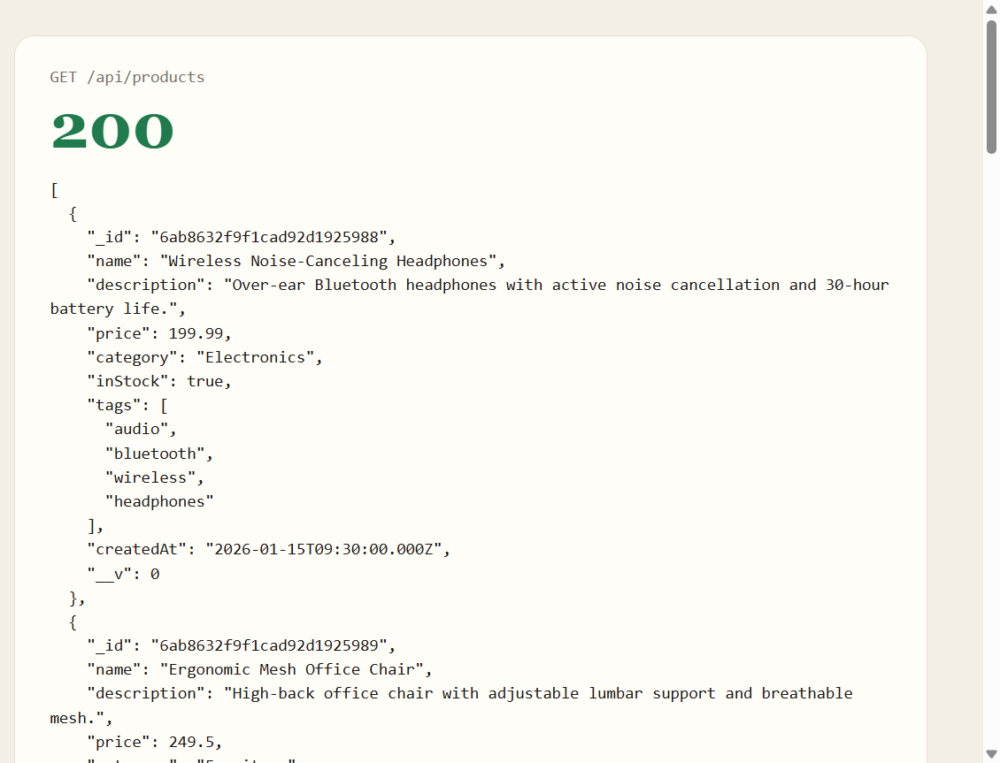
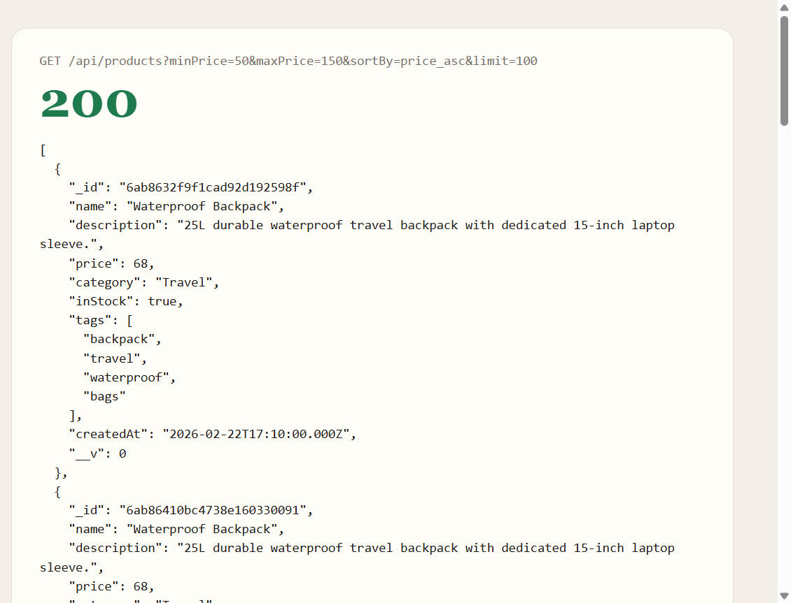
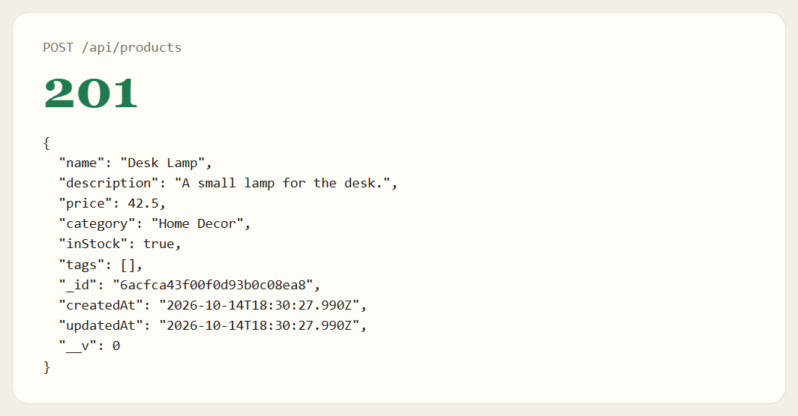
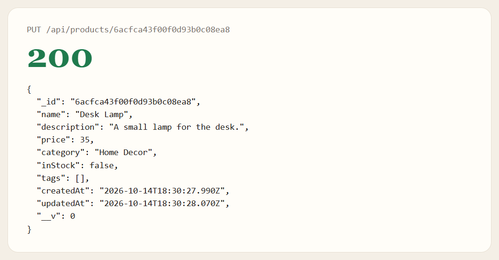
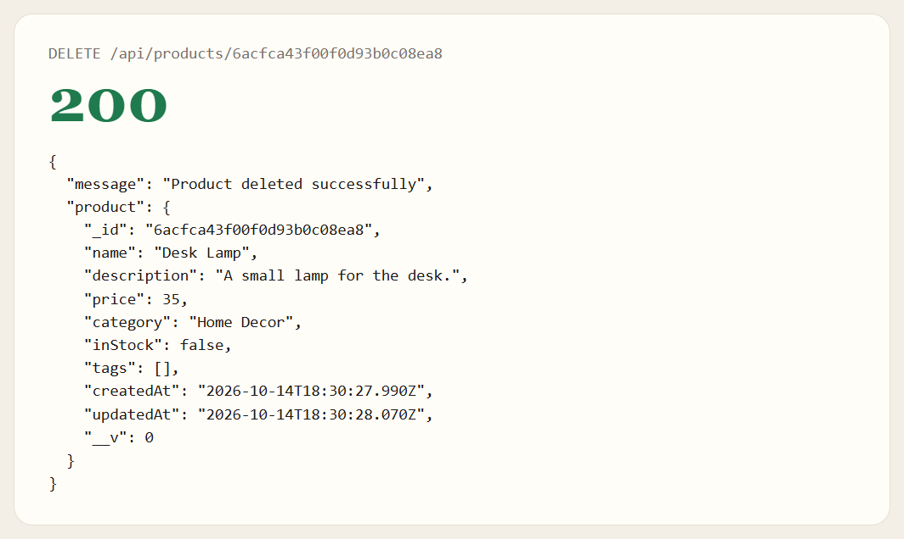
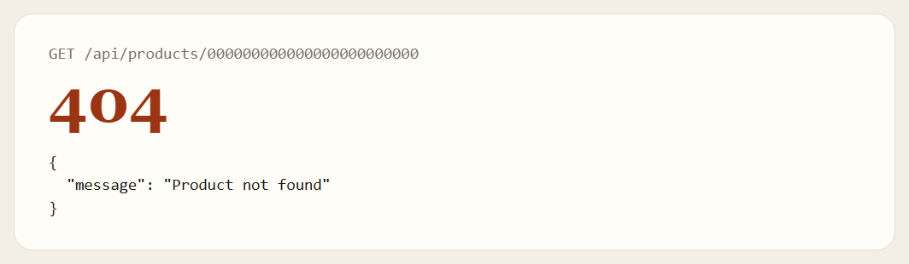
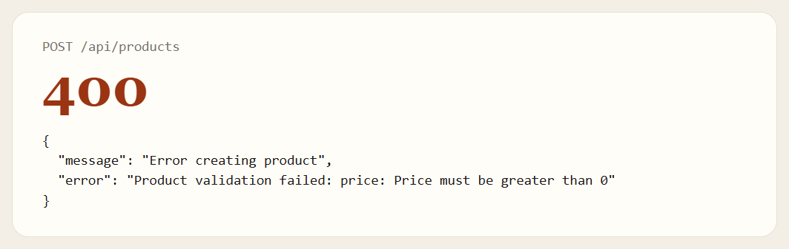
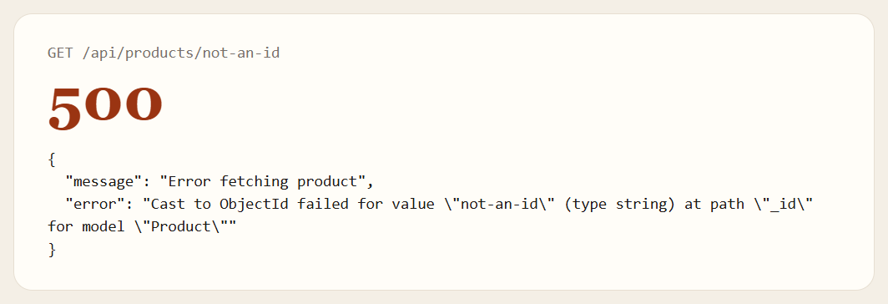

# SBA 13: Integrating a Database

## By [Mamadou Moussa Balde](https://www.linkedin.com/in/2mb/)

This is an Express and Mongoose API for products stored in MongoDB. It does not serve an HTML page. The server reads `PORT` and `MONGO_URI` from the environment. This run listened at http://localhost:3000 and printed "Connected successfully to MongoDB Atlas!"

From this folder:

```
npm install
npm start
```

`npm run dev` starts the same file with nodemon. Every product route is under `/api/products`.

A product needs a name, description, category, and a price greater than 0. `inStock` defaults to `true`. `tags` defaults to `[]`. A field that is not in the schema is dropped. Creating and updating a product sets `createdAt` and `updatedAt`.

## The list

`GET /api/products` returns one page. The page defaults to 1 and the limit defaults to 10. With `limit=100`, the collection returned 31 products. The sample list is stored more than once. The first page is the first 10, in stored order:

| Name | Price | Category | In stock |
| --- | --- | --- | --- |
| Wireless Noise-Canceling Headphones | 199.99 | Electronics | true |
| Ergonomic Mesh Office Chair | 249.5 | Furniture | true |
| Stainless Steel Water Bottle | 29.99 | Fitness & Outdoors | true |
| Mechanical Gaming Keyboard | 89.95 | Electronics | false |
| Organic Whole Bean Coffee | 16.49 | Groceries | true |
| Smart Fitness Watch | 149 | Electronics | true |
| Non-Stick Ceramic Frying Pan | 39.99 | Kitchenware | false |
| Waterproof Backpack | 68 | Travel | true |
| Aromatherapy Essential Oil Diffuser | 24.99 | Home Decor | true |
| Resistance Bands Set | 19.95 | Fitness & Outdoors | true |

Those first copies have a `createdAt` and no `updatedAt`. The headphones copy on this page is dated `2026-01-15T09:30:00.000Z`.



`category` has to match exactly. `category=Electronics` returned 9 products: three copies each of the headphones, the keyboard, and the watch. `category=electronics` returned an empty array.

`minPrice` and `maxPrice` filter the price. `sortBy=price_asc` sorts low to high, and `sortBy=price_desc` sorts high to low. Any other `sortBy` leaves the stored order. A request for prices from 50 to 150, sorted ascending, returned nine products: the backpack at 68, the keyboard at 89.95, and the watch at 149, each three times.



`page=2&limit=2` skipped the first two products and returned the water bottle and the keyboard. `page=-3` is treated as page 1. `limit=0` is treated as the default 10, because `0` is falsy in `parseInt(limit) || 10`.

## Seed, create, update, and delete

`POST /api/products/seed` inserts the 10 products in `data/sampleProductData.js` again. It does not remove the products already stored. This run returned 201 and `{ "message": "Sample products seeded successfully" }`. The 10 new copies were then deleted, and a later list returned 31 products again.

`POST /api/products` saves the body and returns 201. This body included `extra`, which was not saved. `inStock` and `tags` were left out, so they came back as `true` and `[]`.



`PUT /api/products/:id` updates that product and returns it. Setting the price to 35 and `inStock` to false kept the original `createdAt` and moved `updatedAt`.



`DELETE /api/products/:id` returns 200 with the deleted product.



A valid id that is not in the collection returns 404 for get, update, and delete. The message is `Product not found`. Getting the Desk Lamp after it was deleted returned that 404.



## Rejected requests

A price of 0 is rejected. A missing name is rejected with "Product validation failed: name: Path `name` is required."



`not-an-id` is not an ObjectId, so the get returns 500.



`GET /` and `GET /api/nope` are not product routes. Express returns an HTML 404 whose visible text is `Cannot GET /` or `Cannot GET /api/nope`.
